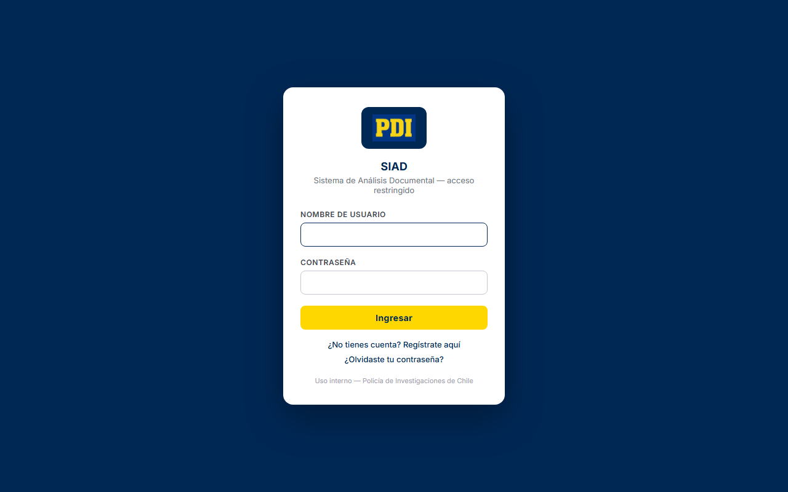
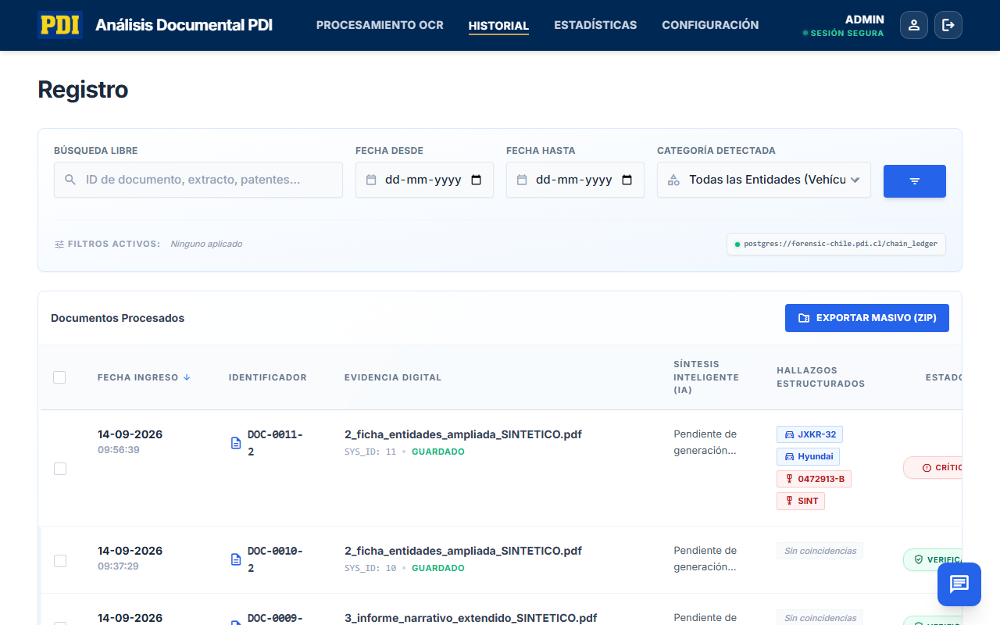
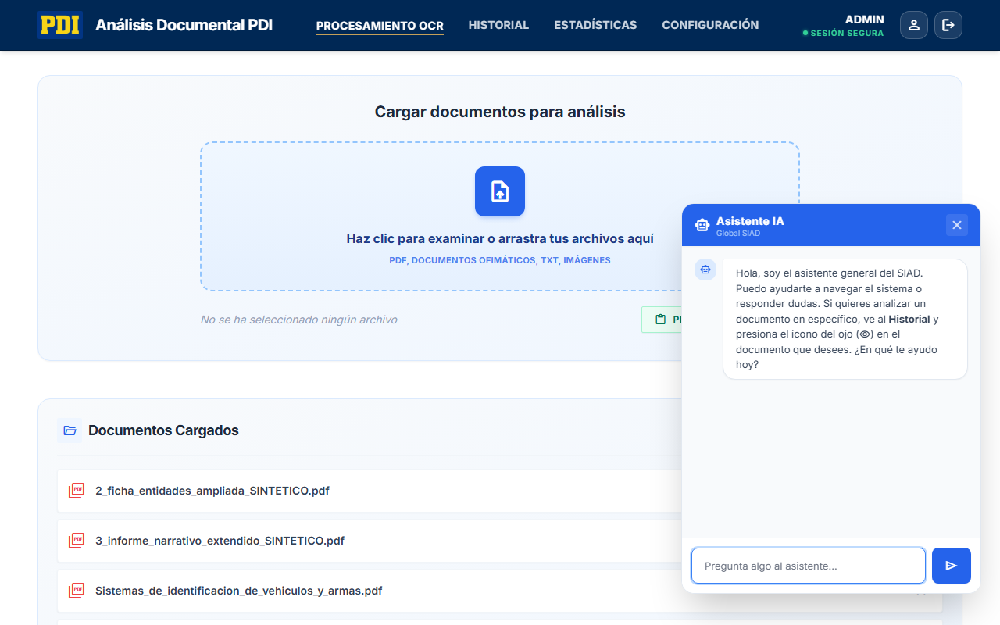
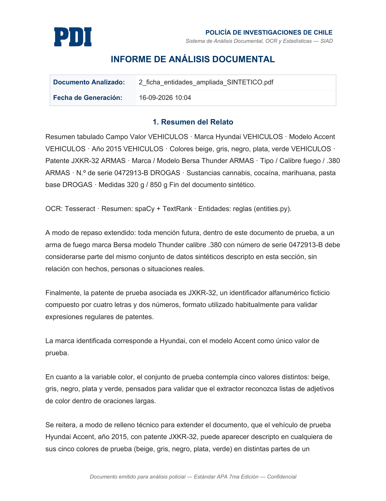

# Sistema de Análisis Documental

## Descripción General del Sistema
El **Sistema de Análisis Documental (SIAD)** automatiza el análisis de actas policiales (PDFs) mediante 5 pilares:
1. **Extracción (OCR):** Digitaliza el texto, incluso de actas escaneadas con baja calidad.
2. **Resumen con IA:** Sintetiza automáticamente el relato policial.
3. **Detección de Entidades:** Identifica y resalta vehículos, armas y drogas.
4. **Historial y Estadísticas:** Guarda los registros de forma inmutable y genera reportes gráficos y en Excel.
5. **Generación de Documentos:** Exporta los resultados directamente a plantillas institucionales de Word.

---

## Motor de Extracción de Entidades y Afinamiento
Este motor funciona mediante reglas heurísticas (sin depender de internet) para garantizar alta precisión y evitar "falsos positivos":

- **Drogas y Sustancias:** Detecta drogas ilícitas comunes mediante diccionarios.
- **Pesajes Inteligentes:** Extrae medidas (gramos, kilos, dosis) **solo si** detecta un contexto de drogas en la oración. Esta *carga de trabajo ajustada por proximidad gramatical* evita errores tontos (ej. confundir el pesaje de un auto con drogas).
- **Afinamiento (Modelos y Años):** Analiza qué palabra está más cerca en el texto para resolver ambigüedades (ej. saber si "modelo" se refiere a un vehículo o a un arma).

---

## Capturas de las Vistas del Sistema

### 1. Vista de Inicio de Sesión (Login)
Permite el acceso seguro y autenticado al sistema.

### 2. Carga y Procesamiento Inicial de Documentos (Home)
Esta es el área de trabajo principal. A la izquierda se visualiza el PDF original recién subido, y a la derecha se gestionan los paneles para extraer el texto y procesar la información paso a paso antes de aplicar la IA.

### 3. Resultados del Análisis (Vista con Resumen y Entidades)
Tras ejecutar el análisis, a la derecha se aprecian los resultados: el motor de resumen extrae el relato esencial y el sistema resalta y clasifica visualmente los hallazgos operativos (vehículos, armas, drogas) listos para exportar.

### 4. Historial de Registros
Muestra un registro inmutable de los documentos previamente analizados y guardados. Cuenta con filtros avanzados por rango de fechas, conteo por categoría de entidades encontradas (vehículos, armas o drogas) y una barra de búsqueda por palabras clave en el relato.

### 5. Estadísticas y Tablero de Control
Un tablero interactivo con indicadores clave de rendimiento (KPIs), gráficos de donas y líneas que muestran el volumen de documentos procesados por día, y listados con el "Top 5" de las entidades (marcas de vehículos, armas y tipos de drogas) que más han sido incautadas históricamente.

---

## Asistente con Inteligencia Artificial (Chat)
Se implementó un widget de Chat interactivo flotante que funciona como Asistente Policial experto. Este asistente es impulsado por inteligencia artificial (modelo `Llama 3.2 11B Vision Instruct`) y opera en dos modalidades inteligentes:

1. **Contexto Específico (Análisis de Documentos):** Al ingresar al detalle de un acta ya procesada en el historial, el asistente responde preguntas basándose de forma *estricta y exclusiva* en el texto (OCR) extraído de ese documento en particular.
2. **Contexto Global (Soporte del Sistema):** Al navegar por el resto de la plataforma, actúa como asistente guía del SIAD, contestando dudas operativas sobre el uso del sistema, cómo funciona la extracción de entidades y cómo exportar información. Filtra estrictamente respuestas que no correspondan al ámbito policial.

---

## Resultado Final: Acta en Word Autogenerada
Una vez procesado el documento, el sistema exporta automáticamente toda la información a la plantilla institucional en formato `.docx`. A continuación, se muestra cómo se ve el documento Word listo para imprimir o editar:

