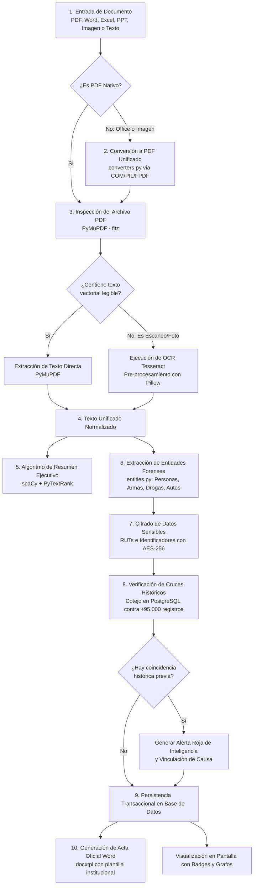
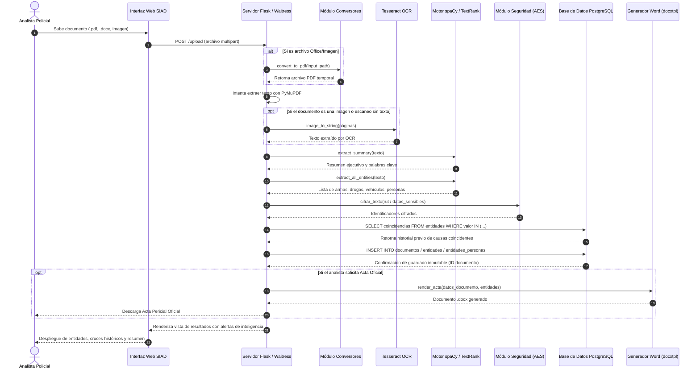
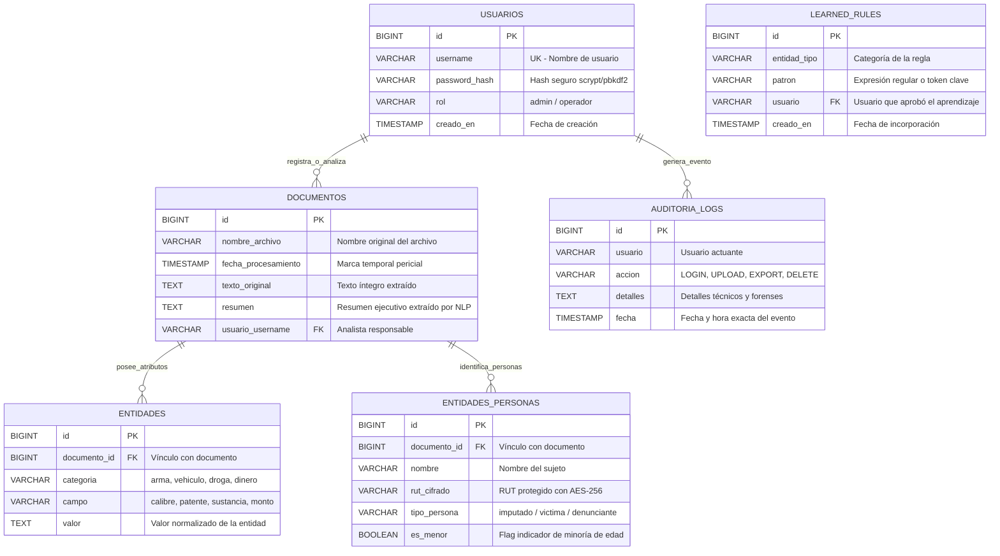
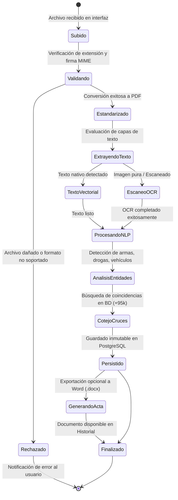
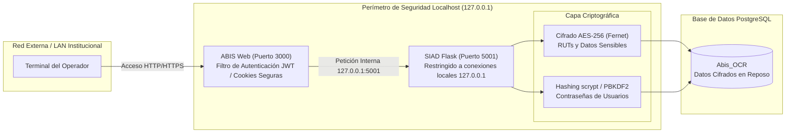

# Manual de Funcionamiento y Arquitectura del Sistema SIAD

**Sistema de Análisis Documental y Pericial (SIAD)**
*Módulo de Inteligencia, Procesamiento de Lenguaje Natural (NLP), OCR y Cruce Forense de Evidencia Documental.*

---

## 1. Visión General del Sistema

El **SIAD** es un sistema especializado diseñado para automatizar la ingesta, análisis, extracción de entidades y cruce histórico de información proveniente de documentos policiales, partes de denuncia, actas periciales, resoluciones judiciales y reportes operativos.

### Objetivos Clave:

1. **Ingesta Multiformato:** Recepción de documentos en formato **PDF, Word (.docx, .doc), Excel (.xlsx), PowerPoint (.pptx), imágenes escaneadas (.png, .jpg) y archivos de texto (.txt)**.
2. **Motor OCR Inteligente:** Detección automática de texto vectorial vs. documentos escaneados/fotografiados mediante **Tesseract OCR** con optimización para vocabulario policial en español.
3. **Extracción Forense de Entidades (NER):** Extracción automatizada y categorizada de:
   - **Personas:** Imputados, víctimas, denunciantes y detección automática de menores de edad.
   - **Armas y Munición:** Tipo, calibre, marca, modelo y número de serie.
   - **Vehículos:** Placas patentes chilenas (formatos antiguo y nuevo), marca, modelo y color.
   - **Sustancias Ilícitas:** Tipo de droga (clorhidrato de cocaína, pasta base, cannabis sativa, drogas sintéticas) y pesaje neto incautado.
   - **Dinero y Especies:** Montos en efectivo, divisas y especies de valor.
4. **Motor de Cruces de Inteligencia en Tiempo Real:** Comparación instantánea de las entidades extraídas contra la base histórica de más de **95.000 registros** en PostgreSQL para identificar reincidencias, vehículos con encargo o armamento vinculado a causas anteriores.
5. **Seguridad y Custodia Pericial:** Cifrado reversible AES-256 (Fernet) para datos personales e identificadores sensibles, control de roles (Administrador/Operador) y almacenamiento inmutable.
6. **Generación Automatizada de Actas:** Emisión instantánea de resúmenes ejecutivos y actas policiales oficiales en formato Word (.docx) listas para firma institucional.

---

## 2. Diagrama General de Arquitectura

El sistema está estructurado bajo una arquitectura por capas desacoplada y segura. SIAD opera como un microservicio backend en Python/Waitress coordinado con la plataforma principal ABIS (Node.js/Express).

```mermaid
flowchart TB
    subgraph Capa_Cliente["1. Capa de Cliente / Analista"]
        Browser["Navegador Web (Analista Policial)<br>UI Glassmorphism / Tailwind CSS"]
        Scanner["Módulo Escáner y Carga Rápida<br>(Drag & Drop / Pegado Directo)"]
        Browser --- Scanner
    end

    subgraph Plataforma_ABIS["2. Plataforma Principal ABIS (Node.js)"]
        AbisServer["Servidor Express (Puerto 3000)<br>Orquestador General"]
        SiadService["Servicio de Integración<br>siadService.js"]
        AbisServer --> SiadService
    end

    subgraph Microservicio_SIAD["3. Servidor SIAD (Python / Waitress)"]
        Waitress["Servidor WSGI Waitress (Puerto 5001)<br>Multi-hilo / 127.0.0.1 (Localhost)"]
        AppRoutes["Controlador Flask (app.py)<br>API REST y Renderizado de Vistas"]
      
        subgraph Motores_Procesamiento["Motores de Análisis"]
            Converter["Conversor Universal<br>(converters.py / Office COM)"]
            OCR["Motor OCR Tesseract<br>(PyMuPDF + Tesseract 5)"]
            NLP["Motor IA / NLP<br>(spaCy + PyTextRank)"]
            Rules["Clasificador Forense<br>(entities.py)"]
            Security["Criptografía y Privacidad<br>(security.py / AES-256)"]
            Exporter["Exportador de Actas<br>(docxtpl / export_stats.py)"]
        end

        Waitress --> AppRoutes
        AppRoutes --> Converter
        AppRoutes --> OCR
        AppRoutes --> NLP
        AppRoutes --> Rules
        AppRoutes --> Security
        AppRoutes --> Exporter
    end

    subgraph Capa_Datos["4. Capa de Persistencia (PostgreSQL)"]
        DB[(Base de Datos Unificada<br>Abis_OCR)]
        DocTable[Tabla: documentos]
        EntityTable[Tabla: entidades - EAV]
        PeopleTable[Tabla: entidades_personas]
        RulesTable[Tabla: learned_rules]
        UsersTable[Tabla: usuarios]
      
        DB --- DocTable
        DB --- EntityTable
        DB --- PeopleTable
        DB --- RulesTable
        DB --- UsersTable
    end

    Browser <-->|HTTP / HTML / WebSocket| AbisServer
    SiadService <-->|HTTP Local / JSON (127.0.0.1:5001)| Waitress
    AppRoutes <-->|psycopg (Pool SQL Seguro)| DB
```

---

## 3. Pipeline de Procesamiento Documental

Flujo paso a paso desde que el analista ingresa un archivo hasta la obtención de los resultados periciales y cruces de inteligencia:



---

## 4. Diagrama de Secuencia del Análisis Pericial

Interacción temporal detallada entre componentes durante el análisis de un expediente:



---

## 5. Modelo de Datos y Esquema Entidad-Relación

La base de datos combina tablas relacionales estructuradas con un modelo **EAV (Entidad-Atributo-Valor)** para garantizar máxima flexibilidad y escalabilidad ante nuevas categorías forenses sin alterar la estructura física de la base de datos.



---

## 6. Diagrama de Estados del Documento

Describe el ciclo de vida inmutable que experimenta cada documento ingresado al sistema:



---

## 7. Arquitectura de Seguridad y Privacidad (Zero-Trust Local)



1. **Aislamiento de Red:** SIAD escucha exclusivamente en `127.0.0.1:5001`. Ningún equipo externo de la red puede comunicarse directamente con SIAD; toda petición pasa previamente validada a través de ABIS o de la sesión autenticada.
2. **Cifrado Reversible de PII:** Los RUTs y datos de identidad se cifran mediante `cryptography.fernet` (AES-256 en modo CBC con HMAC SHA-256). Solo el sistema en ejecución con la clave maestra en el `.env` puede descifrarlos para cotejo o visualización autorizada.
3. **Hashing de Credenciales:** Las contraseñas de acceso nunca se almacenan en texto plano; se utiliza derivación robusta con sal aleatoria.
4. **Control de Acceso Basado en Roles (RBAC):** Separación estricta entre **Administrador** (gestión de usuarios, auditoría, configuración avanzada) y **Operador** (carga de documentos, revisión y exportación).

---

## 8. Mapeo de Archivos del Código Fuente

| Archivo                               | Responsabilidad Principal                                                                                                                                 |
| ------------------------------------- | --------------------------------------------------------------------------------------------------------------------------------------------------------- |
| `app.py`                            | Controlador principal de Flask, rutas de la aplicación web, API REST, manejo de sesiones, orquestador del pipeline.                                      |
| `converters.py`                     | Conversores de documentos a PDF: Microsoft Office vía COM Automation (`win32com`), imágenes vía `Pillow` y texto plano vía `FPDF`.              |
| `entities.py`                       | Motor de Inteligencia y Extracción de Entidades: Reglas heurísticas, expresiones regulares forenses y modelo NER de spaCy (`es_core_news_sm`).        |
| `db.py`                             | Conexión a PostgreSQL con pool, creación de tablas (`init_schema`), consultas parametrizadas contra inyección SQL y funciones de cruces históricos. |
| `security.py`                       | Funciones criptográficas: `cifrar_texto`, `descifrar_texto` con AES-256 (Fernet) y utilidades de saneamiento.                                        |
| `export_stats.py`                   | Generación de estadísticas periciales, reportes agregados y exportación masiva a formatos Excel.                                                       |
| `word_templates/acta_template.docx` | Plantilla oficial de informe pericial utilizada por `docxtpl` para la generación de actas.                                                             |
| `scripts/run_production.bat`        | Script de ejecución para servidores de producción usando Waitress WSGI.                                                                                 |
| `scripts/backup_db.py`              | Script automatizado para generación de respaldos periódicos de la base de datos PostgreSQL.                                                             |

---

## 9. Modo Producción: Despliegue con Waitress y Servicios de Windows

Para desplegar SIAD en un servidor institucional en lugar del entorno de desarrollo:

### 1. Ejecución con Waitress WSGI:

```powershell
.venv\Scripts\waitress-serve.exe --listen=127.0.0.1:5001 --threads=8 app:app
```

* **Multi-hilo:** Soporta múltiples peticiones concurrentes sin bloquear la interfaz.
* **Seguridad:** Aislamiento local en `127.0.0.1`, evitando accesos directos desde fuera del servidor.

### 2. Configuración como Servicio de Windows (Task Scheduler o NSSM):

Permite que el sistema inicie automáticamente al encender el servidor, sin requerir que un operador inicie sesión de forma manual en Windows.

* **Acción:** Ejecutar `scripts/run_production.bat`
* **Desencadenador:** Al iniciar el sistema (`AtStartup`)
* **Permisos:** Ejecutar con los privilegios más altos (`NT AUTHORITY\SYSTEM` o cuenta de servicio dedicada).
